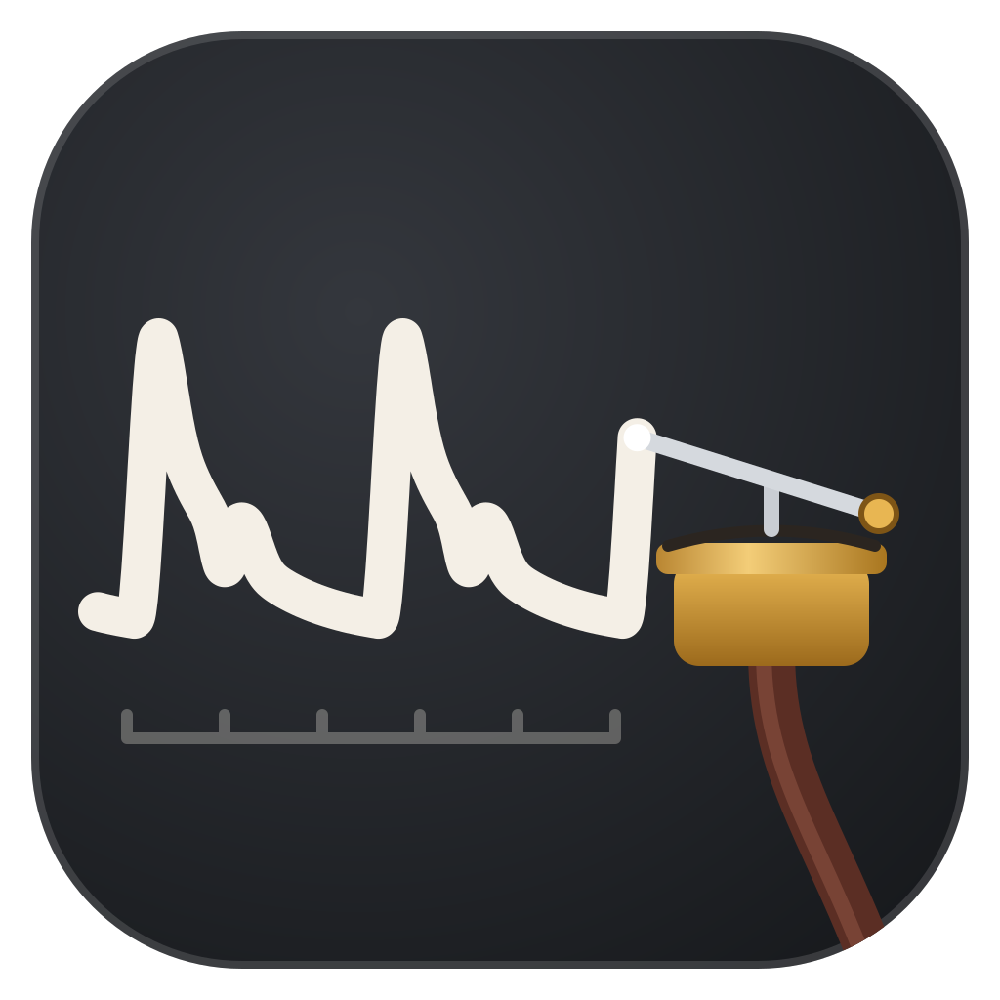

# Tambour

A desktop application for measured data, built on [Marey](https://github.com/Axym-Labs/marey): a
table whose columns carry units, a figure window, and F# scripting underneath both. Every action
taken in the interface is written down as script, so a figure is always reproducible from its
source, and the source runs unchanged in plain `dotnet fsi`.

> Named for the **Marey tambour**, the air capsule Étienne-Jules Marey used to turn a pulse, a
> breath or a muscle twitch into the movement of a recording stylus.

## Status

Not released yet. The first release runs on Marey 1.0.0-rc.1, on Linux and Windows, with no .NET
installed.

## What it does

**Script and figure.** An F# script sits on the left and its figure on the right. F5 or
Ctrl+Enter runs the script in a worker process, and the figure zooms, pans, reads out under the
pointer and shows a live figure's controls. Export writes PNG, PDF or SVG through Marey's own
backends, never through a capture of the window.

**The editor** checks the script as it is typed, with completion, tooltips, the call's overloads
and renaming. A column plotted under the wrong unit is a compile error, underlined where it
happens. Where Marey can tell what a call is missing, such as `Chart.lineIn t x` without the
witnesses of its units, Ctrl+. or the right button on the call offers the fix. Ctrl+., Ctrl+Space
(completion) and F2 (renaming) are Edit menu commands like any other, so their keys can be changed
in Preferences → Keyboard shortcuts.

**GUI actions** (title, labels, log axis, domain, theme, legend, colour, facet, fit, a layer)
edit the script rather than the figure. An action, a fix and typed text share one history, so
Ctrl+Z takes back each in turn.

**Tables.** A table is a grid of typed columns, each with a name and a unit, imported from CSV or
Arrow or typed in. Selecting two columns and pressing Ctrl+Shift+P writes a `plot { }` block for
them into the script; a point picked in the figure marks its row in the grid. Edits to a table
run the figure again and are undone like the script's.

**Workspaces.** Each tab is a workspace with its own scripts, tables, history and worker; nothing
is shared between tabs. A new workspace saves as a single `.tambour` file: a zip holding the
scripts, the tables, the workspace's settings and the figure last shown, which serves as its
thumbnail. File → Export as folder writes the same contents out as plain files. A folder of
scripts opens as a workspace too.

## Using it

```bash
tambour                        # the tabs open at the last quit, or the start view
tambour paper.tambour          # a workspace file
tambour figure.fsx             # a script
tambour analysis/              # a folder, as a workspace
```

A script may take `open Marey`, `open Marey.UnitsOfMeasure` and the SI unit symbols for granted.
A workspace's tables reach its scripts as typed records through a generated `prelude.fsx`: inside
Tambour it binds the columns in the grid, and outside it reads the table files, so with
`#load "prelude.fsx"` and Marey referenced a script runs as it is in `dotnet fsi`.
`#r "nuget: …"` works where a .NET SDK is installed, and says what to install where none is.

A workspace on disk, unpacked or exported:

```text
paper/
  figure.fsx
  tables/trials.csv
  workspace.json               # the script open, the Marey last run on, export DPI and fonts, the layout
  prelude.fsx                  # written by Tambour from the tables
```

Settings are kept in `~/.config/tambour` (`$XDG_CONFIG_HOME`) on Linux and `%APPDATA%\Tambour` on
Windows. An open `.tambour` is unpacked into the cache (`~/.cache/tambour`,
`%LOCALAPPDATA%\Tambour`) and written back to its file on every save, through a temporary file
beside it, so a save cut short leaves the file as it was.

### On Linux

Tambour comes as a tarball, `tambour-<version>-linux-x64.tar.gz`, and as an AppImage. The tarball
unpacks to a directory that runs from anywhere. At each start Tambour writes its desktop entry,
icon, the `application/x-tambour` file type and a thumbnailer under `~/.local/share`
(`$XDG_DATA_HOME`), where they are missing or differ. A `.tambour` then opens in
Tambour from the file manager and shows its figure as a thumbnail, and a Wayland shell shows the
window under Tambour's icon.

On a Wayland desktop the app draws through XWayland, which reports no scaling per screen. At start
it asks the compositor and X11 for each screen and sets `AVALONIA_SCREEN_SCALE_FACTORS` from them,
unless a scaling is already set (`AVALONIA_SCREEN_SCALE_FACTORS`, `AVALONIA_GLOBAL_SCALE_FACTOR`,
`QT_SCREEN_SCALE_FACTORS`, `QT_SCALE_FACTOR`). `tambour --check-scaling` prints what both said and
the factors. A scale changed while the app runs takes effect at its next start.

### On Windows

Tambour comes as a zip, `tambour-<version>-win-x64.zip`. Unpacked anywhere, `tambour.exe` runs
from the folder; nothing is installed, and deleting the folder removes it apart from its settings.
The first start is slower while Windows scans the newly unpacked files. Preferences → Recent files
→ *Open .tambour files with Tambour* registers the file type for the current user.

The package is not code-signed yet, so Windows treats it as coming from an unknown publisher:

- **SmartScreen** says "Windows protected your PC" on the first start. *More info* → *Run anyway*
  starts it, and it does not ask again. Unblocking the zip before unpacking it (its *Properties* →
  *Unblock*) avoids the prompt.
- **Smart App Control**, where it is on, blocks Tambour or one of its libraries ("Smart App Control
  has blocked part of this app") and has no exception for a single app. Tambour runs only with it
  off: *Windows Security* → *App & browser control* → *Smart App Control settings* → *Off*. Recent
  Windows 11 builds let it be turned on again afterwards; older ones only through a reinstall.
  Most machines have it off already, including every machine upgraded from Windows 10.

## Shape

- **Shell:** Avalonia, in F#. Figures are painted by Marey's Skia painter, the same code that
  writes its PNG and PDF exports. A figure past Marey's canvas threshold in primitives goes
  through Marey's GPU renderer where OpenGL 3.3 is available.
- **Scripts run out of process.** A worker holds an F# interactive session and sends each
  figure's scene back in Marey's wire format. Cancelling a script ends the worker; a warm spare
  takes its place.
- **The language service runs out of process too**, on the F# compiler service bundled with the
  app, so completion and the unit error need no .NET SDK.
- **A table reaches a script as a typed record**, regenerated when the columns change, so
  plotting a column under the wrong unit is a compile error.
- **Marey is referenced from NuGet at an exact version**, and only through its public API.

## Building

The .NET 10 SDK (`global.json`). Marey comes from nuget.org, at the exact version
`Directory.Packages.props` pins.

```bash
dotnet build Tambour.slnx
dotnet test Tambour.slnx
dotnet run --project src/Tambour -- --self-check
```

`--self-check` opens a window, paints a figure in it and exits, with 0 if it painted. The tests
that check every GUI action against Marey's examples look for them in a checkout of Marey beside
this one, or in `MAREY_EXAMPLES`, at the commit `Directory.Packages.props` names, and skip without
one.

Three more checks run the app end to end, each exiting 0 when it holds:

- `tambour --check-pane [--scaling 2]`: the figure pane against Marey's PNG export on both of its
  paint paths, and a million points from their bytes to the screen, timed only where the GPU
  renderer runs on a GPU;
- `tambour --check-analysis <script>`: the language service, cold, to a script's first error;
- `tambour --check-package`: a script opened, drawn, its unit error shown and taken back, an
  action applied and taken back, and a PNG exported that `renderPng` draws pixel for pixel.

## Packages

`tools/package.sh [version]` writes to `artifacts/package` a self-contained Linux tarball (and an
AppImage of it where `appimagetool` is on the path) and a Windows zip. Nothing is written next to
the executable: settings, caches and the workers' sockets go to the XDG directories on Linux and to
the user's application data on Windows (the sockets to its temporary directory), so the same
directory can also be wrapped as a Flatpak or an AUR package. `tools/no-dotnet.sh` runs a command
in a bubblewrap sandbox that hides every .NET installation:

```bash
tools/no-dotnet.sh path/to/tambour-<version>-linux-x64/tambour --check-package
```

[Third-party notices](THIRD-PARTY-NOTICES.md) list what a package carries and under which licences.

## Licence

[MPL-2.0](LICENSE). Changes to Tambour's own files stay open; using it, bundling it or building
on it does not put anything else under the same terms.
